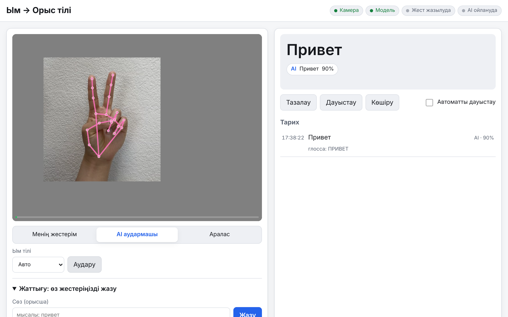

# Ым → Орыс тілі (жест аудармашысы)

Веб-камера алдында ым тілімен (немесе қимылмен) көрсетілген жестерді **орыс тіліндегі мәтінге** аударатын веб-қосымша. Нәтижені дауыстап оқуға (ru-RU сөйлеу синтезі) және көшіруге болады.



Қолдың қозғалысын браузердің ішінде [MediaPipe Hand Landmarker](https://ai.google.dev/edge/mediapipe/solutions/vision/hand_landmarker) анықтайды. Жестерді тану үшін үш режим бар:

| Режим | Қалай жұмыс істейді | Интернет / кілт |
|---|---|---|
| **Менің жестерім** | Өзіңіз жазып алған жестерді (DTW + kNN) танитын офлайн жіктеуіш. Ең сенімді режим. | Қажет емес |
| **AI аудармашы** | Жест аяқталғанда 4–8 кадр Claude (Anthropic) моделіне жіберіледі; ол орыс/қазақ ым тілі мен дактильді түсіндіреді. | Anthropic API кілті |
| **Аралас** | Алдымен өз жестеріңізден іздейді; сенімді сәйкестік болмаса — AI-ға жібереді. | Кілт (AI бөлігі үшін) |

## Талаптар

- **Node.js 22** немесе жаңарақ
- **Chrome** немесе **Edge** (WebAssembly + WebGL қолдауымен)
- Веб-камера
- (AI режимі үшін) Anthropic API кілті — <https://console.anthropic.com/> → *API Keys*

## Орнату және іске қосу

```bash
npm install                 # тәуелділіктер + қол моделін жүктеу (public/models/hand_landmarker.task)
cp .env.example .env        # .env ішіне ANTHROPIC_API_KEY=... кілтін жазыңыз
npm start
```

Браузерде ашыңыз: **<http://localhost:3000>** (басқа порт керек болса: `PORT=8080 npm start`).

Егер `npm install` кезінде модель жүктелмесе (мысалы, интернет болмаса), кейін қайталаңыз:

```bash
npm run setup
```

Тесттер: `npm test`.

## Қалай қолдануға болады

1. **Камераны қосу** батырмасын басып, камераға рұқсат беріңіз.
2. Жоғарыдан **Режим** таңдаңыз және ым тілін (Авто / Орыс ым тілі / Қазақ ым тілі).
3. Қолыңызды кадрға кіргізіп, бір жестті көрсетіңіз де, қолды тоқтатыңыз (~0,5 с). Жүйе жесттің басы мен соңын өзі анықтайды.
4. Аударма төмендегі өріске қосылады. **Дауыстау** — орысша дауыстап оқу, **Көшіру** — мәтінді көшіру, **Тазалау** — тазалау. **Тарих** тізімінде барлық танылған жестер сақталады.

### Өз жестеріңізді үйрету («Менің жестерім»)

1. **Жаттығу: өз жестеріңізді жазу** бөлімінде **Сөз (орысша)** өрісіне мағынасын жазыңыз (мысалы, `Привет`).
2. **Жазу** батырмасын басыңыз: 3-2-1 санағынан кейін жестті бір рет көрсетіңіз.
3. Әр сөз үшін кемінде **3 мысал** жазыңыз (әртүрлі қашықтықта, сәл басқаша) — дәлдік артады.
4. Жестер браузерде (localStorage) сақталады. **Экспорт** / **Импорт** арқылы JSON файлға сақтап, басқа компьютерге көшіруге болады.

## Шектеулер

- Ым тілін бірнеше суреттен (кадрдан) AI арқылы түсіндіру — **шамамен** ғана. Ым тілінде қозғалыс, мимика, кеңістік маңызды; модель қателесуі мүмкін. Нәтижемен бірге сенімділік (confidence) көрсетіледі.
- Ең сенімді нәтиже — **«Менің жестерім»** режимі (өз жестеріңізбен үйретілген).
- Камера тек **localhost** немесе **HTTPS** арқылы жұмыс істейді (браузер талабы). Басқа құрылғыдан ашу үшін HTTPS керек.
- Ұзын сөйлемдерді емес, жеке сөздер мен қысқа фразаларды таниды.

## Құпиялылық

- Видео серверге жіберілмейді: қолды анықтау толығымен браузерде жүреді.
- Тек **AI аудармашы** / **Аралас** режимдерінде, жест аяқталған сәтте, бірнеше кадр (JPEG) сервер арқылы **Anthropic API**-ге жіберіледі. Сервер оларды сақтамайды.
- «Менің жестерім» режимі толығымен офлайн жұмыс істейді; жестер тек сіздің браузеріңізде сақталады.

---

## Кратко на русском

**Что это:** веб-приложение, которое переводит жесты (русский / казахский жестовый язык, дактиль, бытовые жесты) с веб-камеры в русский текст и может озвучить его (ru-RU).

**Требования:** Node.js 22+, Chrome или Edge, веб-камера; для режима AI — ключ Anthropic API (<https://console.anthropic.com/>).

**Запуск:**

```bash
npm install            # зависимости + загрузка модели руки
cp .env.example .env   # впишите ANTHROPIC_API_KEY=...
npm start              # затем откройте http://localhost:3000
```

Если модель не скачалась при установке — `npm run setup`.

**Режимы:**
- **Менің жестерім** («Мои жесты») — офлайн-распознавание жестов, которые вы записали сами (≥3 примера на слово; экспорт/импорт JSON). Самый надёжный режим, ключ не нужен.
- **AI аудармашы** («AI-переводчик») — 4–8 кадров жеста отправляются в Claude, который интерпретирует жест.
- **Аралас** («Смешанный») — сначала свои жесты, при низкой уверенности — AI.

**Ограничения:** интерпретация жестового языка по нескольким кадрам — приблизительная; надёжнее всего режим своих жестов. Камера работает только на `localhost` или по HTTPS.

**Конфиденциальность:** распознавание рук идёт в браузере; кадры отправляются в Anthropic API только в режимах AI / смешанном и на сервере не сохраняются.
